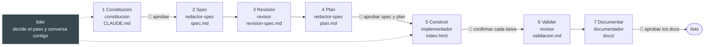
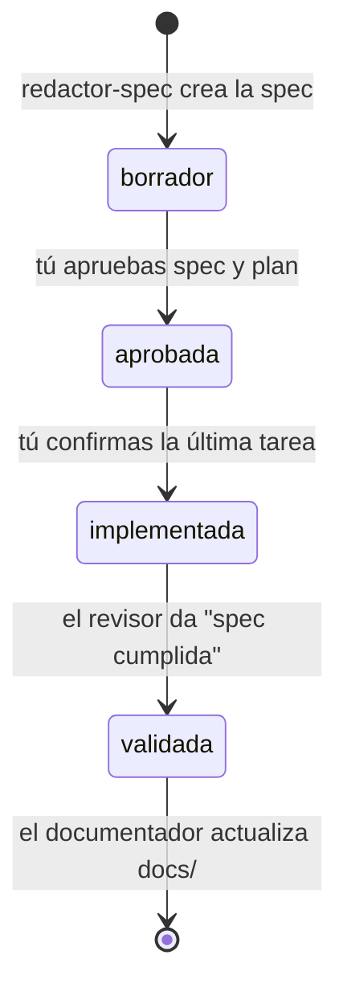
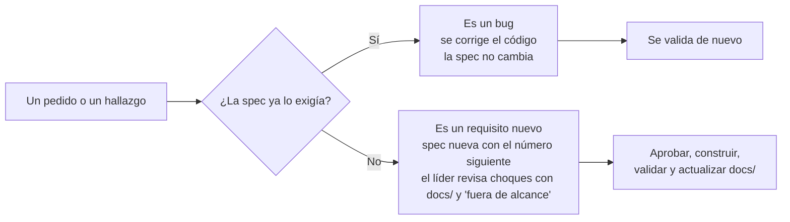

# sdd-agents

**Un equipo de seis agentes de Claude Code que te lleva de una idea a una herramienta con especificación, validada en el navegador y documentada. Tú apruebas en cada puerta; los agentes hacen el trabajo y lo dejan escrito en archivos.**

Pensado para personas que construyen herramientas HTML con Claude y no quieren pegar ocho prompts en el orden correcto. Funciona desde la terminal y desde VS Code.

> **Estado:** probado de punta a punta con `claude -p` sobre una carpeta limpia. Falta probarlo en la extensión de VS Code. Ver [Limitaciones conocidas](#limitaciones-conocidas).

---

## Contenido

1. [Qué es y qué problema resuelve](#qué-es-y-qué-problema-resuelve)
2. [Cómo funciona, en una imagen](#cómo-funciona-en-una-imagen)
3. [Requisitos](#requisitos)
4. [Inicio rápido](#inicio-rápido)
5. [Estructura de este repositorio](#estructura-de-este-repositorio)
6. [Estructura de una herramienta](#estructura-de-una-herramienta)
7. [El equipo de agentes](#el-equipo-de-agentes)
8. [Los estados de una spec y las puertas](#los-estados-de-una-spec-y-las-puertas)
9. [Un recorrido completo](#un-recorrido-completo)
10. [Cómo se escribe un requisito (EARS)](#cómo-se-escribe-un-requisito-ears)
11. [Pedir un cambio: bug o requisito nuevo](#pedir-un-cambio-bug-o-requisito-nuevo)
12. [Por qué está diseñado así](#por-qué-está-diseñado-así)
13. [Personalizar el equipo](#personalizar-el-equipo)
14. [Limitaciones conocidas](#limitaciones-conocidas)
15. [Solución de problemas](#solución-de-problemas)
16. [Preguntas frecuentes](#preguntas-frecuentes)
17. [Fuentes y créditos](#fuentes-y-créditos)

---

## Qué es y qué problema resuelve

Cuando alguien construye una herramienta con un prompt largo, el resultado suele ser una página que parece lista y no se puede mantener:

- Las decisiones quedaron en un chat que ya no existe.
- Nadie sabe qué tiene que seguir funcionando cuando se cambia algo.
- Nadie comprobó que funcione contra algo escrito de antemano.

**Spec-Driven Development (SDD)** invierte el orden: primero se escribe qué debe hacer la herramienta y cómo se comprueba, y después el agente la construye contra esa especificación.

Este repositorio es un kit que automatiza ese método con un equipo de agentes. Cada agente es un archivo de texto `.md` en la carpeta `.claude/agents/`: no hay nada que instalar ni programar.

| Sin el kit | Con el kit |
|---|---|
| Recuerdas qué prompt pegar y en qué orden | Escribes una frase de arranque y el líder decide el paso |
| El flujo vive en tu portapapeles | El flujo vive en `.claude/agents/`, versionado con la herramienta |
| El agente se detiene cuando tú lo recuerdas | Se detiene en cada puerta, con el estado escrito |
| Lo decidido queda en el chat | Lo decidido queda en `specs/` y `docs/` |

Lo que decides tú no cambia: aprobar, comprobar y leer.

---

## Cómo funciona, en una imagen

El `lider` coordina siete etapas. Los círculos rojos son puertas: el agente se detiene y espera tu aprobación escrita.



Dos ideas sostienen todo:

1. **El trabajo pasa por archivos, no por el chat.** Cada agente deja su resultado en un archivo y responde con una sola línea que apunta a él.
2. **Cada agente solo puede lo que su rol necesita.** El revisor no corrige, el implementador no cambia la spec, el líder no escribe código.

---

## Requisitos

| Requisito | Para qué |
|---|---|
| Claude Code, en la terminal o en la extensión de VS Code | Ejecuta los agentes |
| Python 3 | El revisor levanta un servidor local para validar la página |
| Plugin **Playwright** de Claude Code (`/plugin`, buscar "playwright") | El revisor abre el navegador y prueba cada criterio |

Sin Playwright el kit sigue funcionando, pero el `revisor` solo puede revisar la spec: no puede validar la herramienta.

---

## Inicio rápido

1. **Clona este repositorio** y crea una carpeta para tu herramienta, por ejemplo `registro-detenciones`.

   ```bash
   git clone https://github.com/RaulChihuaicura/sdd-agents.git
   mkdir registro-detenciones
   ```

2. **Copia el contenido de `kit/` dentro de tu carpeta**, incluida la carpeta oculta `.claude/`.

   ```bash
   # macOS y Linux
   cp -r sdd-agents/kit/. registro-detenciones/
   ```

   ```powershell
   # Windows (PowerShell)
   Copy-Item -Path sdd-agents\kit\* -Destination registro-detenciones -Recurse -Force
   ```

3. **Edita `CLAUDE.md`** en tu carpeta: cambia el título y la frase de abajo por lo que hace tu herramienta.

4. **Abre Claude Code dentro de esa carpeta.** En la terminal, `claude` desde ella; en VS Code, abre la carpeta y luego Claude Code. Los agentes solo se cargan al abrir la sesión: si copiaste los archivos con Claude ya abierto, ciérralo y ábrelo de nuevo.

5. **Comprueba que cargó.** Pregunta: `¿Qué rol tienes en esta carpeta?` Debe responder que es el líder.

6. **Cuéntale lo que quieres, en una frase:**

   ```text
   Quiero una herramienta que <qué hace>. La va a usar <quién>.
   ```

7. **Responde en cada puerta.** El líder te pedirá tres cosas: aprobar la constitución, responder una entrevista de una pregunta a la vez, y aprobar la spec y el plan juntos. Aprobar no es construir: la construcción la pides aparte.

¿No tienes una herramienta en mente? Hay tres casos chicos en [`docs/casos-practica.md`](docs/casos-practica.md).

---

## Estructura de este repositorio

```text
sdd-agents/
├── README.md                  ← este archivo
├── kit/                       ← lo que copias a tu carpeta de trabajo
│   ├── CLAUDE.md              ← plantilla: pone al líder a cargo
│   └── .claude/
│       └── agents/
│           ├── lider.md
│           ├── constitucion.md
│           ├── redactor-spec.md
│           ├── revisor.md
│           ├── implementador.md
│           └── documentador.md
├── docs/
│   └── casos-practica.md      ← tres herramientas chicas para practicar
└── .gitignore
```

---

## Estructura de una herramienta

Esta es la convención de carpetas que el equipo genera y mantiene en tu carpeta de trabajo. Es la parte más importante: quien llegue mañana, persona o agente, sabe qué hace la herramienta, por qué es así y cómo se comprueba.

```text
registro-detenciones/
├── CLAUDE.md                      ← constitución + cómo se trabaja aquí
├── .claude/
│   └── agents/                    ← los seis agentes
├── specs/                         ← la historia: una carpeta por cambio
│   ├── 001-registro/
│   │   ├── spec.md                ← el QUÉ y el POR QUÉ, con su línea Estado:
│   │   ├── plan.md                ← el CÓMO, con tareas y "Hecho cuando:"
│   │   ├── revision-spec.md       ← los huecos que encontró el revisor
│   │   ├── progreso.md            ← lo que hizo el implementador
│   │   └── validacion.md          ← la tabla de pruebas en el navegador
│   └── 002-totales-en-rojo/       ← un cambio posterior = una spec nueva
│       ├── spec.md
│       └── plan.md
├── docs/                          ← cómo funciona HOY (vivo)
│   ├── negocio/reglas.md          ← reglas vigentes, en lenguaje de negocio
│   ├── tecnica/arquitectura.md    ← partes, funciones y decisiones
│   └── cambios.md                 ← qué cambió en la última actualización
└── index.html                     ← la herramienta
```

| Carpeta o archivo | Qué guarda | Cuándo cambia |
|---|---|---|
| `CLAUDE.md` | Los cinco principios y las cuatro reglas fijas | Casi nunca |
| `.claude/agents/` | El equipo de agentes | Casi nunca |
| `specs/NNN-nombre/` | La spec y el plan de **un** cambio | Nunca después de implementada: queda como historia |
| `docs/` | Cómo funciona la herramienta ahora | Después de cada cambio validado |
| `index.html` | La herramienta | Una tarea a la vez |

**La diferencia que importa:** `docs/` responde *cómo funciona hoy*. `specs/` responde *por qué llegó a ser así*.

### Las cuatro reglas fijas de la constitución

El agente `constitucion` las escribe siempre en el `CLAUDE.md`, junto con cinco principios propios de tu herramienta:

1. Antes de tocar el HTML, lee `docs/` y la spec activa: la carpeta de número más alto en `specs/`.
2. Un cambio entra como spec nueva en `specs/` y se aprueba antes de tocar el HTML.
3. No modifiques una spec que ya está implementada. Corregir el código para que cumpla una spec no es modificarla, y cambiar su línea `Estado:` tampoco.
4. `docs/` describe la herramienta como está hoy: se actualiza solo después de validar.

---

## El equipo de agentes

Seis agentes. Cada uno es un archivo en [`kit/.claude/agents/`](kit/.claude/agents/) con su rol, sus herramientas permitidas, su protocolo y sus reglas duras.

| Agente | Rol | Qué escribe | Qué no puede hacer |
|---|---|---|---|
| [`lider`](kit/.claude/agents/lider.md) | Orquestador | Solo la línea `Estado:` | Escribir spec, plan o código |
| [`constitucion`](kit/.claude/agents/constitucion.md) | Define las reglas que no cambian | `CLAUDE.md` | Escribir sin tu aprobación |
| [`redactor-spec`](kit/.claude/agents/redactor-spec.md) | Convierte decisiones en especificación | `spec.md`, `plan.md` | Tocar el HTML |
| [`revisor`](kit/.claude/agents/revisor.md) | QA antes y después de construir | `revision-spec.md`, `validacion.md` | Corregir spec o código |
| [`implementador`](kit/.claude/agents/implementador.md) | Construye | `index.html`, `progreso.md` | Hacer más de una tarea, cambiar la spec |
| [`documentador`](kit/.claude/agents/documentador.md) | Deja la documentación al día | `docs/` | Documentar lo que no se construyó |

### `lider`: el orquestador

- **Herramientas:** `Read`, `Glob`, `Grep`, `Edit`, `Agent`.
- **Qué hace:** lee `CLAUDE.md` y la spec activa, decide qué paso toca según su `Estado:` y lanza al agente correspondiente. **Es quien conversa contigo:** hace la entrevista y pide las aprobaciones, porque los subagentes no pueden mantener una conversación.
- **Cómo entra en la sesión:** el `CLAUDE.md` de tu herramienta le pide a Claude que actúe siempre como el líder.
- **Qué decide según el estado:**

  | Situación | Acción |
  |---|---|
  | La constitución no está aprobada | Lanza a `constitucion` en modo proponer, te muestra la propuesta y espera |
  | Pedido nuevo o cambio | Revisa choques, te entrevista, lanza a `redactor-spec` y a `revisor` |
  | `aprobada` | Lanza al `implementador` con la primera tarea sin marcar |
  | `implementada` | Lanza al `revisor` en modo validar |
  | `validada` con `docs/` sin actualizar | Lanza al `documentador` |

- **Reglas duras:** nunca avanza sin una aprobación explícita ("aprobado", "sí, constrúyelo"; un "ok" o un silencio no cuentan). Solo edita la línea `Estado:`. Recomienda siempre la opción que hace menos y cumple lo pedido.

### `constitucion`: las reglas que no cambian

- **Herramientas:** `Read`, `Write`, `Edit`, `Glob`.
- **Dos modos:**
  - *proponer*: escribe cinco principios cortos y comprobables sobre qué tecnología se usa, cómo se trabaja y qué no se hace (máximo 15 líneas). No escribe ningún archivo.
  - *escribir*: con el texto que tú aprobaste, lo deja en `CLAUDE.md` junto con las cuatro reglas fijas.
- **Límite importante:** los principios fijan el marco, no el producto. No decide qué datos guarda la herramienta, en qué idioma habla ni qué controles tiene: eso se decide en la spec.

### `redactor-spec`: la especificación

- **Herramientas:** `Read`, `Write`, `Edit`, `Glob`, `Grep`.
- **Tres modos:**
  - *spec*: crea `specs/NNN-nombre/spec.md` con `Estado: borrador` y las secciones Contexto y objetivo, Usuarios, Requisitos, Criterios de aceptación, Fuera de alcance y Dudas abiertas.
  - *ajustar*: aplica las decisiones que tomaste tras la revisión.
  - *plan*: escribe `plan.md` con "Cómo se construye" (decisiones con su alternativa descartada) y hasta 4 tareas de menos de 20 minutos, cada una con su "Hecho cuando:".
- **Reglas de la spec:** requisitos en [EARS](#cómo-se-escribe-un-requisito-ears), máximo 6 por spec, un requisito por frase, nada que no se pueda medir. Lo que no se sabe va a "Dudas abiertas" como `[NECESITA ACLARACIÓN: pregunta concreta]`, nunca se inventa.
- **Si un cambio necesita más de 3 tareas:** avisa que conviene partirlo en dos specs.

### `revisor`: la calidad, antes y después

- **Herramientas:** hereda las de la sesión (incluido Playwright) pero tiene `Edit` denegado.
- **Dos modos:**
  - *spec*: revisa la spec como un QA exigente y escribe `revision-spec.md` con máximo 8 hallazgos en cuatro bloques: ambigüedades, contradicciones, casos límite que faltan y requisitos sin prueba. **Detecta, no corrige.**
  - *validar*: levanta un servidor local (`python -m http.server 8765`), abre la página con Playwright, hace en ella exactamente la prueba que dice cada criterio y escribe `validacion.md` con una tabla `RF | qué probaste | qué esperabas | qué pasó | Cumple / No cumple` y un veredicto.
- **Por qué importa:** el agente no se evalúa con su opinión ("ya funciona"), sino contra lo que acordaste por escrito antes de construir.

### `implementador`: una tarea a la vez

- **Herramientas:** `Read`, `Write`, `Edit`, `Glob`, `Grep`.
- **Tres modos:**
  - *construir*: hace **una** tarea del plan, toca solo `index.html`, anota en `progreso.md` cómo comprobarla y se detiene. No abre el navegador: la comprobación la haces tú.
  - *marcar*: cuando confirmas que funciona, marca la tarea con `[x]` en `plan.md`.
  - *corregir*: si la validación encontró un requisito que no se cumple, corrige el código para que cumpla lo que la spec ya decía.
- **Contexto mínimo:** solo ve la constitución, la spec y el plan. No ve la conversación de la entrevista.

### `documentador`: la documentación viva

- **Herramientas:** `Read`, `Write`, `Edit`, `Glob`, `Grep`.
- **Condición:** solo actúa con la spec en `validada`.
- **Qué escribe:** `docs/negocio/reglas.md` (tabla `Regla | Origen | Se comprueba así`, en lenguaje de negocio, sin términos técnicos), `docs/tecnica/arquitectura.md` (cómo está construida hoy) y `docs/cambios.md` (qué cambió, para que lo revises).
- **Regla dura:** documenta solo lo que está en el código y fue validado.

---

## Los estados de una spec y las puertas

Cada `spec.md` lleva una línea `Estado:` justo debajo del título. El líder la lee para saber qué toca y nunca la adelanta sin tu frase clara.



| Paso | Quién lo mueve | Con qué señal |
|---|---|---|
| `borrador` → `aprobada` | Tú | Lees `spec.md` y `plan.md` y dices "aprobada la spec y el plan" |
| `aprobada` → `implementada` | Tú | Compruebas cada tarea en la página y confirmas la última |
| `implementada` → `validada` | El `revisor` | Prueba cada criterio en el navegador y da el veredicto "spec cumplida" |

Las puertas donde el agente se detiene y espera:

1. **La constitución:** lees los cinco principios y dices "aprobada", o qué cambiar.
2. **La entrevista:** respondes de a una pregunta. Si no sabes, "la opción más simple".
3. **La spec y el plan:** los lees en el editor y los apruebas juntos.
4. **Cada tarea:** la compruebas en la página antes de que se marque.
5. **La documentación:** lees la lista de cambios y la apruebas.

---

## Un recorrido completo

Los mensajes del usuario van en negrita; lo demás lo hace el equipo.

1. **"Quiero un registro de detenciones de turno donde se anota máquina, motivo y minutos, y se ve el total por máquina. Lo va a usar el supervisor de turno."** El líder lanza a `constitucion`, que propone cinco principios y se detiene.
2. **"Aprobada."** Se escribe el `CLAUDE.md` con los principios y las cuatro reglas.
3. **Entrevista.** El líder pregunta de a una (máquinas, minutos, motivo, si guarda datos, si se edita) y tú respondes. Lo que quede fuera se anota en "Fuera de alcance".
4. **Spec y revisión.** `redactor-spec` escribe `specs/001-registro/spec.md` con `Estado: borrador`; el `revisor` busca huecos; el líder te muestra como máximo 4 decisiones.
5. **"Aprobada la spec y el plan. Construye la primera tarea."** El estado pasa a `aprobada`; el `implementador` hace una tarea y se detiene. Tú compruebas la página.
6. **"La tarea 1 funciona."** Se marca la tarea. Se repite hasta completar el plan, y el estado pasa a `implementada`.
7. **"Valida la herramienta."** El `revisor` prueba cada criterio en el navegador. Si encuentra un requisito que falla, **"Corrígelo."**; no hace falta spec nueva, porque la spec ya lo exigía.
8. **"Nuevo requisito: si el total de una máquina pasa de 60 minutos en el turno, quiero verlo destacado en rojo."** El líder revisa que no choque con `docs/` ni con un "fuera de alcance" anterior y crea `specs/002-...` con el número de requisito siguiente. La spec 001 no se toca.
9. **"Valida y actualiza la documentación."** Se revalida y el `documentador` deja `docs/` al día.

Un extracto, abreviado, de la spec que produjo un ensayo de este recorrido:

```markdown
# Registro de detenciones de turno
Estado: borrador

## Requisitos
- RF-1: EL SISTEMA ofrece para la máquina solo estas opciones: Inyectora 1, Inyectora 2, Acolchadora y Cerradora.
- RF-3: SI el motivo está vacío o solo tiene espacios, ENTONCES EL SISTEMA no registra la detención y muestra un mensaje que indica que el motivo es obligatorio.

## Criterios de aceptación
| RF | Se comprueba así |
|----|------------------|
| RF-1 | Se abre la lista de máquinas: aparecen exactamente las cuatro y no se puede escribir otra. |
| RF-3 | Se deja el motivo vacío, y luego solo con espacios, con 10 minutos: se ve el mensaje y la lista no cambia. |
```

---

## Cómo se escribe un requisito (EARS)

Un requisito es una promesa que se puede comprobar. EARS son cinco moldes de frase que obligan a decir cuándo pasa algo y qué hace la herramienta, sin dejar nada a la interpretación.

| Molde | Se usa cuando | Ejemplo (reserva de salas) |
|---|---|---|
| `EL SISTEMA ...` | Siempre es cierto | EL SISTEMA ofrecerá solo las salas A, B y C. |
| `CUANDO ..., EL SISTEMA ...` | Responde a algo que pasa | CUANDO una persona reserve una sala libre, EL SISTEMA la mostrará en la agenda del día. |
| `MIENTRAS ..., EL SISTEMA ...` | Dura mientras algo se cumple | MIENTRAS una sala esté reservada, EL SISTEMA no permitirá reservarla en ese horario. |
| `SI ..., ENTONCES EL SISTEMA ...` | Errores y casos límite | SI la hora de término es anterior a la de inicio, ENTONCES EL SISTEMA no registrará la reserva. |
| `DONDE ..., EL SISTEMA ...` | Solo si existe una opción | DONDE la sala tenga proyector, EL SISTEMA lo indicará en la reserva. |

**Antes:** "El sistema debe validar bien las horas." No se sabe qué es "bien" ni cómo comprobarlo.

**Después:** "SI la hora de término es anterior o igual a la de inicio, ENTONCES EL SISTEMA rechazará la reserva con el mensaje 'La hora de término debe ser posterior a la de inicio'." Y su prueba: reservar con término igual al inicio, con término anterior y con una hora vacía; no debe aparecer ninguna reserva y debe verse el mensaje.

Tres reglas para escribir bien:

1. **Una frase por requisito.** Si necesitas un "y", son dos.
2. **Nada que no se mida.** "Rápido" o "fácil" no son requisitos.
3. **Con su prueba.** Si no se te ocurre cómo comprobarlo, está mal escrito.

Y una regla sobre lo que no sabes: se marca como `[NECESITA ACLARACIÓN: pregunta concreta]`. **Un hueco visible es información; una suposición silenciosa es deuda.**

---

## Pedir un cambio: bug o requisito nuevo

Ante cualquier pedido o hallazgo, el líder se hace una pregunta: **¿la spec ya lo exigía?**



- **"El RF-3 aceptaba -15 minutos"** es un bug: la spec ya decía que los minutos eran enteros mayores que 0.
- **"Quiero el total en rojo sobre 60 minutos"** es un requisito nuevo: nace `specs/002-...`.

Así cada cambio queda escrito, con su fecha y su motivo, en vez de perderse en una conversación.

---

## Por qué está diseñado así

- **Archivos en vez de chat.** Cada agente deja su resultado en un archivo y devuelve una sola línea que apunta a él. El implementador recibe el contexto mínimo (la spec y el plan), no el historial de la entrevista. Si cierras la sesión, la carpeta conserva todo.
- **Roles con límites reales.** Las herramientas permitidas de cada agente están en su frontmatter (`tools` o `disallowedTools`), no solo en sus instrucciones. Un agente que revisa no puede editar.
- **Humano en el ciclo.** El agente se detiene en cada puerta. La spec y los tests son tu capa de control: léelos. El agente puede equivocarse y quien firma la herramienta eres tú.
- **Una tarea a la vez.** Una tarea se revisa en minutos; todo de una vez se revisa nunca.
- **Topes que mantienen todo revisable.** Máximo 6 requisitos por spec, 8 hallazgos por revisión, 4 decisiones para ti por vuelta y 4 tareas por plan. Sin esos topes, en el primer ensayo una spec creció a 19 requisitos y un cambio de un solo pedido generó 14 hallazgos.
- **Sin sorpresas de producto.** La constitución no decide el comportamiento de la herramienta, y el líder recomienda la opción que hace menos. Lo que nadie pidió no se construye.

---

## Personalizar el equipo

Los agentes son texto: modifícalos para que encajen con tu forma de trabajar.

- **Cambiar los topes:** edita el límite de requisitos en `redactor-spec.md` o el de hallazgos en `revisor.md`.
- **Guardar las tareas en otra herramienta:** pídele a Claude que cambie `plan.md` por tu gestor de tickets.
- **Un commit por tarea:** agrégalo al protocolo del `implementador`. **Una rama por spec:** agrégalo al `lider`.
- **Otro tipo de herramienta:** el kit está escrito para herramientas de un solo archivo `index.html`. Para otro stack, ajusta la constitución, el `implementador` y los pasos de validación del `revisor`.

Una forma práctica de empezar: pídele a Claude que lea `.claude/agents/` y proponga los cambios que necesitas, y revisa el resultado antes de aceptarlo.

---

## Limitaciones conocidas

- **Probado con terminal, falta VS Code.** El recorrido completo se ensayó con `claude -p` sobre una carpeta limpia. Todavía no se ha repetido con la extensión de VS Code.
- **Los agentes se cargan al abrir la sesión.** Un agente copiado con Claude ya abierto no se ve hasta reabrirlo.
- **Los subagentes no conversan.** Por eso la entrevista y las aprobaciones las hace el `lider` en la sesión principal, y por eso el `lider` es la sesión misma y no un subagente.
- **Validar requiere Playwright.** El plugin no abre archivos con `file://`: el revisor sirve la página en `http://127.0.0.1:8765`.
- **El ensayo se hizo con un solo modelo y sin otros plugins.** Un entorno con plugins que disparan sus propios flujos puede interferir con el líder.
- **Pensado para herramientas chicas.** Un solo HTML, specs de hasta 6 requisitos. No es un reemplazo de un proceso de ingeniería completo.

---

## Solución de problemas

| Síntoma | Qué hacer |
|---|---|
| El agente no se presenta como líder | Cierra Claude y ábrelo de nuevo **dentro** de la carpeta de tu herramienta. Comprueba que existen `CLAUDE.md` y `.claude/agents/` con los seis archivos |
| El líder se salta una aprobación | Dilo explícitamente ("no avances sin mi aprobación") y revisa que el `CLAUDE.md` conserve la sección "Cómo se trabaja aquí" |
| El revisor no puede validar | Falta el plugin Playwright o Python. Instálalos; mientras tanto el revisor puede revisar la spec |
| El puerto 8765 está ocupado | El revisor usa el 8766 por su cuenta |
| La spec creció demasiado | Mueve lo que no se pidió a "Fuera de alcance" y pide una spec nueva para lo demás |
| Quieres cambiar algo ya validado | Pídeselo al líder: será una spec nueva, no un parche |

---

## Preguntas frecuentes

**¿Tengo que saber programar?** No. Lees specs y compruebas la página; los agentes escriben el código. Ayuda saber leer lo que producen: eso es parte de tu control.

**¿Cuánto tarda?** Depende del modelo y de la herramienta. En mediciones con prompts equivalentes sobre Sonnet, cada paso tomó entre 10 y 60 segundos de espera del agente; la validación completa de una herramienta chica tomó alrededor de un minuto.

**¿Puedo usarlo con una herramienta que ya existe?** Sí: copia el kit sobre su carpeta y empieza por la constitución. La primera spec describirá lo que la herramienta ya hace, y la revisión mostrará qué huecos tiene.

**¿Por qué seis agentes y no uno?** Porque separar roles impide que un mismo agente construya y se apruebe a sí mismo. Quien escribe la spec no la implementa, y quien valida no corrige.

**¿Y si prefiero no usar agentes?** El mismo método funciona con prompts pegados a mano, uno por paso: constitución, spec, revisión, plan, implementar, validar, cambio y documentar. Los agentes son ese método ya armado.

**¿Es un framework?** No. Es un conjunto de archivos de texto. Los frameworks de SDD más completos (Spec Kit, por ejemplo) hacen lo mismo con más piezas; conviene entender primero el método y después decidir si necesitas uno.

---

## Fuentes y créditos

El método combina ideas de dos fuentes públicas. Los agentes, plantillas y textos de este repositorio son de redacción propia: no se copia el texto de ninguna de ellas.

- **BettaTech**, video [*Esto es lo que aprendí adaptando Claude Code para SDD*](https://www.youtube.com/watch?v=ElGlTv2A_bM) y su repositorio de ejemplo [`betta-tech/harness-sdd`](https://github.com/betta-tech/harness-sdd): un agente por etapa con un líder que no escribe código, el estado en archivos, la puerta de aprobación humana entre la spec y el código, y los agentes que devuelven una sola línea con una referencia.
- **MoureDev**, curso de Spec-Driven Development y su repositorio [`mouredev/hello-sdd`](https://github.com/mouredev/hello-sdd): la constitución como paso previo, el flujo por fases y la notación EARS para los requisitos.

## Licencia

[MIT](LICENSE). Puedes usar, copiar, modificar y redistribuir el kit, incluso en proyectos comerciales, conservando el aviso de copyright.
